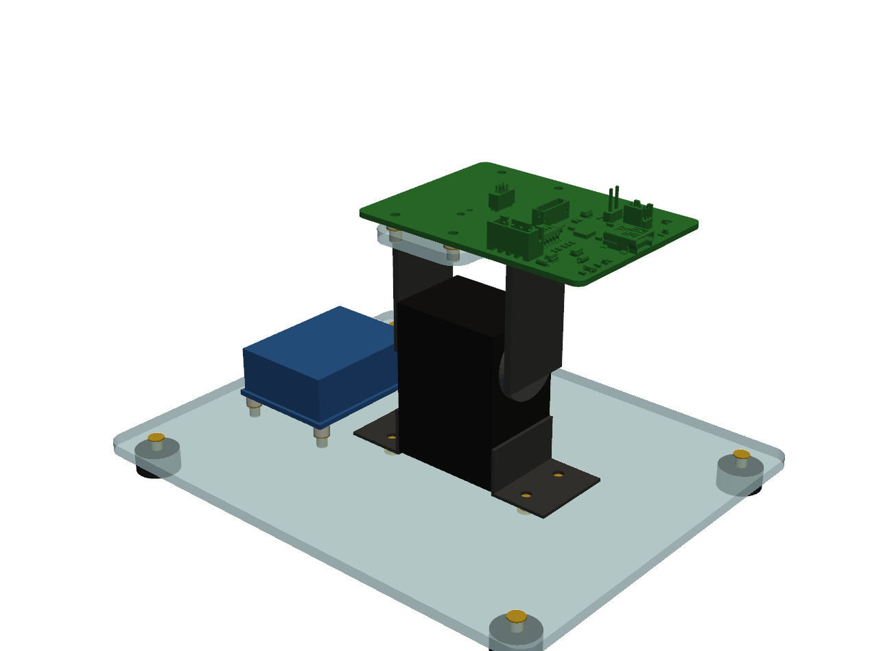
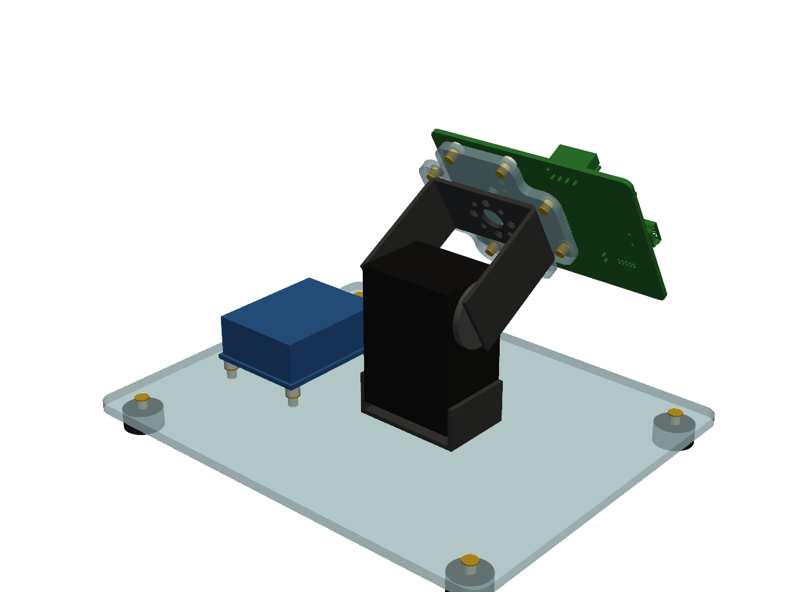
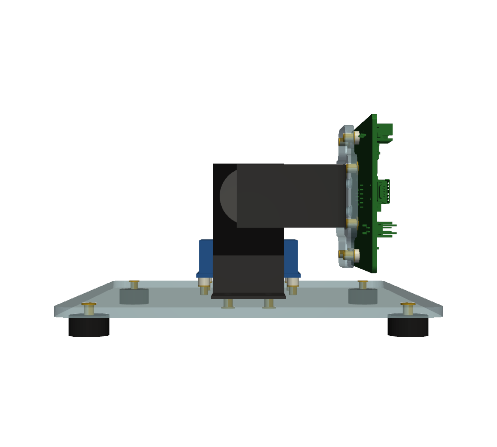
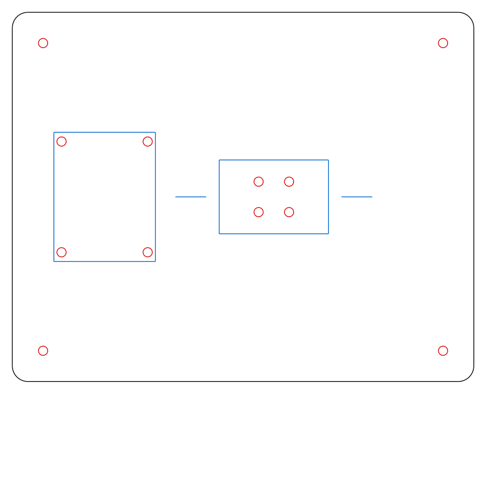
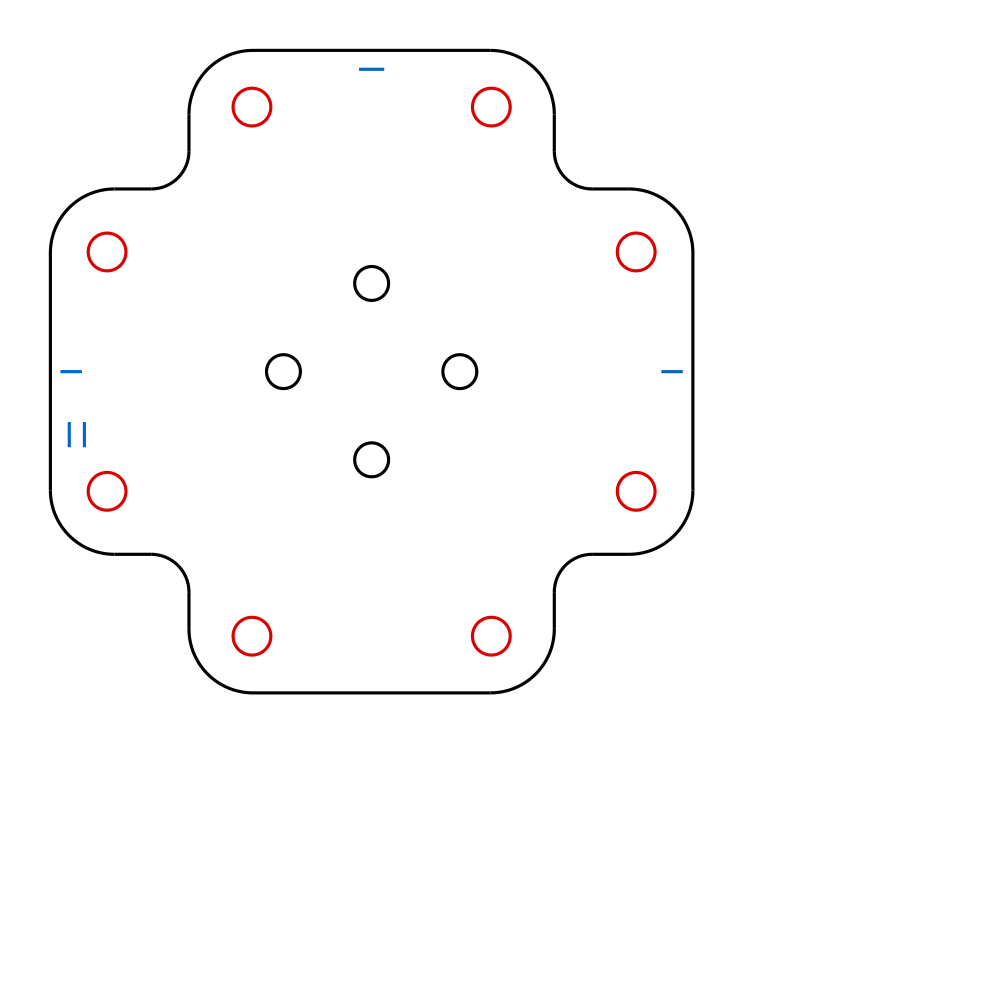

# Activity-detector tilt stand

A servo-driven stand that tilts a **tagbase-v7**, with a tag in its case, through
programmed angles. It exercises the ADXL362/ADXL367 activity and inactivity
detectors with known, repeatable changes in the gravity vector. It is built from
off-the-shelf Hiwonder parts plus two laser-cut 1/8" acrylic plates.

```
 tagbase-v7 (+ tag in its case)
 ── 1/16" nylon spacers ──
 adapter plate (acrylic, cross)           ┐
 straight U bracket                       ├ rotor: tilts about a horizontal axis
 LX-16A horn / rear bearing  ─────────────┘
 LX-16A servo (upright), hung about 3 mm above the floor of
 the bottom bracket by its flange screws
 base plate (acrylic) + BusLinker V3.0 on 1/8" spacers
 rubber feet
```



| | |
|---|---|
|  |  |

## Evaluation of the plan

**The stack is sound, and the bracket choice gives the right motion.** In the
bottom bracket the LX-16A stands upright with its output shaft horizontal. The
U bracket therefore swings the tagbase through gravity (a tilt), not around a
vertical axis (a yaw). That matters. A yaw move changes the accelerometer
reading only through centripetal and tangential terms, about 0.1 g at best. A
tilt of θ changes one axis by sin θ and another by 1 − cos θ, up to the full
±1 g. The detector thresholds can therefore be mapped directly to angles:

| threshold | tilt from level that crosses it (sin θ) |
|---|---|
| 100 mg | 5.7° |
| 250 mg | 14.5° |
| 500 mg | 30° |
| 1 g | 90° |

The LX-16A resolves 0.24° per count (0–1000 over 240°), with 0.3° rated
accuracy. Near level that is about 4–5 mg per step, fine enough to bracket a
threshold.

Things the plan has to live with, in rough order of importance:

1. **Dynamic acceleration from the lever arm.** The tag sits about 44 mm above
   the axis. At the servo's top speed (0.19 s/60° at 7.4 V, ≈ 5.5 rad/s) the
   centripetal term ω²r is ≈ 0.14 g, and there are start/stop spikes on top of
   that. That makes fast moves a good *activity* stimulus and a poor
   quasi-static one. For threshold calibration, use the move-time parameter: 90°
   over 2 s gives ω²r ≈ 3 mg, and over 1 s ≈ 11 mg.
2. **Servo hold jitter.** A position servo hunting around its set point puts
   mg-level vibration into the tag, which can keep an inactivity timer from
   expiring at low thresholds. After each move, consider unloading the motor
   (LX-16A `SERVO_LOAD_OR_UNLOAD_WRITE`). The gravity torque on the rotor is
   small, about 0.2 kg·cm at 90°, so the gear train should hold position
   unpowered. Confirm that on the real servo.
3. **Cable drag.** The tagbase's USB and JST cables ride on the rotor. Give them
   a slack loop along the tilt axis. Cable whip on a fast move is another
   acceleration source.
4. **Levelling.** No surface on the stand is a reliable reference. Set the
   servo to its centre position (500) before bolting on the U, then trim with
   the servo's angle-offset adjustment until the tag's own accelerometer reads
   0 g on the in-plane axes.
5. **Magnetics.** The servo motor sits about 40 mm from the tag. That is fine
   for accelerometer tests; do not trust magnetometer data (CompassTag) taken
   on this stand.
6. **Servo supply.** The LX-16A is rated **6–8.4 V**. The BusLinker accepts up
   to 14 V and Hiwonder suggests a 12 V adapter, which suits its higher-voltage
   servos. Assume the BusLinker passes its input straight to the servo bus and
   feed it 7.4–7.5 V (≥ 2 A; LX-16A stall current is 1.1–1.9 A).

## Two tagbase orientations

The adapter plate carries the tagbase's four-hole pattern (H1–H4, 42 × 19 mm,
taken from `tagbase-v7.kicad_pcb`) twice, rotated 90°, one per arm of the
cross:

| | board long axis | swings | tilt range (model) |
|---|---|---|---|
| **A** (holes at x ±9.5, y ±21) | along the tilt axis; USB end away from the BusLinker | the 50.8 mm width | **±106.8°** |
| **B** (holes at x ±21, y ±9.5) | across the axis | the 70 mm length, 51 mm on one side of the holes | +114.8° / **−75.8°** |

In both cases the first contact is the tagbase meeting the base plate. A tilts
the tag about the board's long axis and B about its short axis, so between
them both in-plane accelerometer axes see a full ±1 g. B reaches only −75.8° on
its long-overhang side. To go further, raise the bottom bracket on spacers.

The plate is a cross, not a square, because it only needs to support its four
holes. A full square reaches J1's leads in both orientations.

## Fasteners and inserts

All inserts are **McMaster 94615A111** (E-Z LOK 260-002BR): 2-56, 0.156"
long, flange 0.187" × 0.020". **Laser the holes at 0.118" and drill them to
1/8" afterwards**, as on the multicharger, then **press the inserts from the
top**, flange up. The one exception is the four bottom-bracket inserts, which
go in from below (see the table). The 0.011" of body that stands proud underneath
is fine, because the base plate sits on rubber feet. Flange up does three
things:

- the spacers bear on the flanges;
- the board gains 0.5 mm of clearance;
- nothing on the underside of the adapter plate can rock it on the U bracket.
  The B-pattern inserts overhang the U's bent edges by about 0.4 mm.

| joint | hardware | why |
|---|---|---|
| bottom bracket → base plate | The **uncut** bracket. 4 inserts at the floor's diagonal ring holes (±4.95, ±4.95), **pressed in from below**, flange down. Those four floor holes drilled to 1/8", so the floor drops over the insert bodies standing 0.28 mm proud. 4 × 2-56 × 3/16" pan head from inside the bracket. | The bracket is 1.5 mm sheet, too thin to tap, and its Ø2.1 holes are too small to pass a 2-56. But the servo does not rest on the floor. Its flange screws hold its bottom end **about 3.07 mm above the floor**, which the drawings imply: the back-face holes (2.25 mm from the servo's end) meet the flange row 6.82 mm above the floor's underside, and the horn-face holes (6.0 mm) meet the row at 10.57 mm, both an offset of 4.57 mm, and the real parts confirm the room. A pan head is 1.35 mm tall and Ø4.2, so it fits in the gap and bears on the floor around the 1/8" hole. Flange down, because the screw pulls the insert upward. The proud bodies locate the bracket. A 3/16" screw engages about 3.5 mm and stays inside the insert. |
| U bracket → adapter plate | 4 × 2-56 × 5/16" 82° flat head, countersunk from the top, nut (or nylock) inside the U | These are the U base's four Ø3.2 holes, on its axes at (±7, 0) and (0, ±7); the Ø2.2 diagonal holes are too small for 2-56. J101's pogo tails and the tag case screws sit over this area, so the plate top there must be flush. That rules out insert flanges. There is about 22 mm of room above the servo for the nuts. |
| tagbase → adapter plate | 4 × 2-56 × 1/4" pan head, 4 × **1/16"** nylon spacers, inserts | 1/4" ends 0.8 mm short of the bottom of the insert, so it cannot reach the U bracket. |
| BusLinker → base plate | 4 × 2-56 × 5/16" pan head, 4 × **1/8"** nylon spacers, inserts | Taller than the tagbase spacers, for the board's untrimmed DC-jack and terminal-block leads. The BusLinker's holes are 3 mm (measured), which passes 2-56 with about 0.4 mm of play per side. |
| feet | 4 inserts at the corners, optional | For screw-on bumpers; ignore them for adhesive feet. |

**Tagbase underside.** The KiCad 3D export of tagbase-v7 puts its lowest feature,
J1's (JST-XH) leads, 1.81 mm below the board. That is more than the 1/16"
spacer. The cross outline keeps J1 off the plate in both orientations. The
board file carries J101's Mill-Max 855 model hidden, so kicad-cli leaves it
out; `build_model.py` adds it from `BoardDesigns/libraries/packages3D/`. Its
tails end 1.02 mm below the board, which leaves a 1.08 mm gap over the plate,
which is flat there (no flanges or screw heads). The fit check against the
export plus the connector reports clear in both orientations. Case-screw heads
and dowels under J101 are not modelled; on the multicharger the same 1/16"
works.

## Parts list

| qty | part | source |
|---|---|---|
| 1 | LX-16A serial bus servo (includes horn, rear bearing and screws) | Hiwonder |
| 1 | LX-16A bracket set; uses the **bottom** and **straight U** brackets | Hiwonder |
| 1 | BusLinker V3.0 debug board | Hiwonder |
| 1 | 7.4–7.5 V, ≥ 2 A supply, 5.5 × 2.1 mm plug | — |
| 1 | tagbase-v7 | this repo |
| 2 | 1/8" acrylic plates (`plates/`) | laser cut |
| 20 | 2-56 press-in inserts, 94615A111 (8 adapter, 4 BusLinker, 4 bottom bracket, 4 feet) | McMaster |
| 4 | 2-56 × 3/16" pan head (bottom bracket, from inside) | — |
| 4 + 4 | 2-56 × 5/16" 82° flat head + hex or nylock nuts | — |
| 4 | 2-56 × 1/4" pan head | — |
| 4 | 2-56 × 5/16" pan head | — |
| 4 + 4 | #2 nylon spacers, 1/16" and 1/8" | on hand |
| 4 | rubber feet | — |

## Assembly

1. Cut the plates. Drill the red (`CUT_PILOT`) holes to 1/8". Countersink the
   four central adapter holes from the top (the engraved axis ticks are on the
   top face).
2. Press the inserts: the four under the bottom bracket from below, every other
   insert from the top.
3. Drill the bottom bracket's four diagonal floor holes, at 45° on its ring, to
   1/8". Set the bracket over the four proud insert bodies inside its engraved
   rectangle, flanges across the engraved axis line. Screw it down from inside
   with 2-56 × 3/16" pan heads.
4. Mount the servo in the bracket with its own M2 screws, horn facing away from
   the BusLinker (+x). Check that the screw heads clear the servo's bottom end.
   Connect it to the BusLinker and command position 500.
5. Bolt the adapter plate to the U base, then the U to the horn and the rear
   bearing, with the plate level.
6. Mount the tagbase on pattern A or B. The single engraved tick marks the A
   arm, the double tick the B arm.
7. Mount the BusLinker in its engraved rectangle, servo ports toward the servo.

## Plate drawings

`plates/teststand-{base,adapter}-plate-1to1.pdf` are printable full-size
checks: print at 100% (no fit-to-page), confirm the 100 mm and 4 in scale bars,
then lay the bracket, servo and BusLinker on the page. Dashed grey outlines show
where each should land. They come from the same geometry as the DXFs.

`plates/teststand-{base,adapter}-plate-{in,mm}.dxf`. The inch files match
`Acrylic/multicharger-acrylic.dxf`; both carry `$INSUNITS`. Layers:

- `CUT` (white): outline and 2-56 clearance holes, cut to final size;
- `CUT_PILOT` (red): insert holes at 0.118", drilled to 1/8" after cutting;
- `ENGRAVE` (blue): placement rectangles (bottom bracket, BusLinker), the
  tilt axis, and the A/B keys.

| base plate, 150 × 120 mm | adapter plate, 51 × 51 mm cross |
|---|---|
|  |  |

Coordinates in mm. The base plate's origin is the servo/bracket centre; the
adapter plate's is the U-bracket ring centre. x is along the tilt axis.

| plate | x | y | laser | final | role |
|---|---|---|---|---|---|
| base | ±4.95 | ±4.95 | 0.118" | 0.125" | bottom-bracket inserts, pressed from below; under the bracket's diagonal ring holes |
| base | −69, −41 | ±18 | 0.118" | 0.125" | BusLinker inserts (36 × 28 pattern, from Hiwonder) |
| base | −75, 55 | ±50 | 0.118" | 0.125" | foot inserts, optional |
| adapter | (±7, 0), (0, ±7) | | 0.106" | 0.106" | U bracket (its Ø3.2 holes), countersunk from the top |
| adapter | ±9.5 | ±21 | 0.118" | 0.125" | tagbase pattern A |
| adapter | ±21 | ±9.5 | 0.118" | 0.125" | tagbase pattern B |

## Sources for the numbers

- **Brackets and servo geometry:** Hiwonder's 1:1 DXFs, read entity by entity,
  in `Mechanical/Components/` (`Bottom Bracket.dxf`, `Staight U-shaped
  Bracket.dxf`, `LX-16A+mounting holes.dxf`, from Hiwonder's download folder),
  2026-10-21. They replace the web-page images this design first used.
  - Bottom bracket: 1.5 mm sheet, 35.5 outside / 32.5 between the flanges,
    24 wide; flanges 10 and 13.7 tall, holes Ø2.0 on 20.5 mm centres; eight
    Ø2.1 floor holes on a Ø14 ring.
  - Straight U: 1.5 mm sheet, 36.6 between the arms, 22 wide, 38 tall. The
    base has Ø3.2 holes on its axes at (±7, 0) and (0, ±7), Ø2.2 on the
    diagonals and a Ø8 centre. **The web image read had the Ø3 and Ø2 holes
    swapped**, which put the adapter's U screws on the Ø2.2 holes. The horn
    centre is 34.0 mm below the base's outer face and 4.0 mm below the arm tip.
  - LX-16A: 45 × 24.5, 32 between the horn and back faces, output 10.0 mm from
    the top end. The spline is 1.7 mm proud of the front face and the rear boss
    2.6 mm proud of the back. The mounting holes are Ø1.6 on 20.5 mm centres.
- **LX-16A ratings:** 6–8.4 V, 0–240°, 0.19 s/60° at 7.4 V
  ([Hiwonder](https://www.hiwonder.com/products/lx-16a)). `LX16A.STEP` in
  `Mechanical/Components/` agrees on the shaft position (10.1 mm from the end)
  and the horn-to-idler span (36.8 mm). It is not used in the model: its rear
  housing cover is missing, so the motor shows through.
- **BusLinker V3.0:** 42 × 33 × 15 mm, holes 36 × 28, 5–14 V; holes 3 mm on 28 × 36 mm centres, both measured by the designer 2026-10-19
  ([manual](https://docs.hiwonder.com/projects/BusLinker/en/latest/docs/1_BusLinker_V3.0_Servo_Debugging_Board_User_Manual.html)).
- **Insert:** McMaster's table row for 94615A111. Its page cannot be fetched
  automatically, so the cross-reference to E-Z LOK 260-002BR (0.125" hole)
  comes from [Olander](https://www.olander.com/items/260-002BR).
- **tagbase-v7:** read from `BoardDesigns/Bases/tagbase-v7/tagbase-v7.kicad_pcb`
  (holes, outline) and from its `kicad-cli` 3D export (underside fit). The
  board is 50.8 × 69.85 mm, with H1–H4 2.5 mm holes at (±21, ±9.5) about their
  centroid.

### VERIFY: inferred, not read off a drawing

Most of this table was settled by the vendor DXFs, and the servo gap by the
parts themselves. Neither row moves a plate hole. Measure them when the servo and brackets arrive, before cutting; each is
one parameter in `teststand.py`, and `make all` rebuilds and rechecks.

| parameter | value | assumed | affects |
|---|---|---|---|
| `HORN_PROUD` | horn face beyond the servo body; the rear idler takes the rest of the U's 36.6 − 32 = 4.6 mm | 2.0 mm | where the U is centred (0.3 mm toward the idler) |
| `SERVO_GAP` | floor top to servo bottom end | 3.07 mm, from the hole heights in the drawings | **Confirmed on the real servo and bracket, 2026-10-24:** plenty of room for the pan heads. |

The servo, horn, brackets and BusLinker are envelope solids in the model, sized
from the drawings.

## Files and how to rebuild

```
teststand.py       parameters and plate geometry; the one source of truth
make_plates.py     plates/*.dxf, *.svg, *-1to1.pdf
build_model.py     teststand.FCStd, out/teststand-assembly.step, out/checks.txt
render.py          renders/*.png
```

`make all`, or `make plates` / `make model` / `make renders`. The model step
needs FreeCAD 1.1 (`freecadcmd`) and KiCad (`kicad-cli`, for the tagbase's 3D
export). Renders need pyvista (`~/cq-env`). Both plates are checked for edge
distance (≥ 2.5 mm) and webs (≥ 1.5 mm) on every build. The DXFs were
re-imported into FreeCAD and all 24 holes matched.

In `teststand.FCStd`, the `Rotor` App::Part tilts about the line
x, through (0, 0, 39.57). Pose it by editing Rotor → Placement → Angle.
`TagbaseB` and `TagSpacersB` are hidden; swap visibility with the A parts to
see orientation B.
