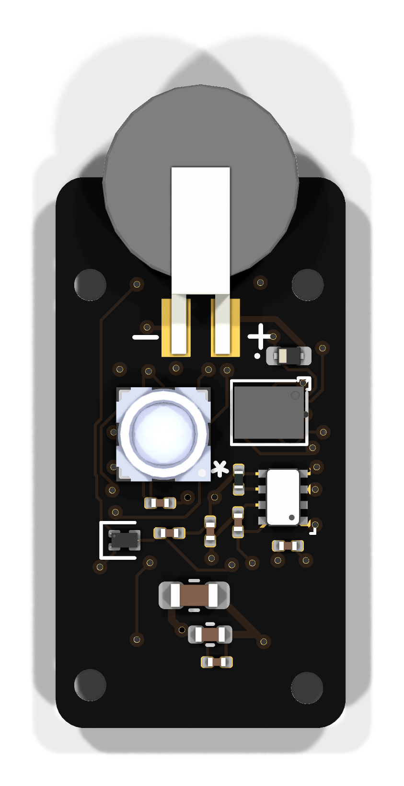
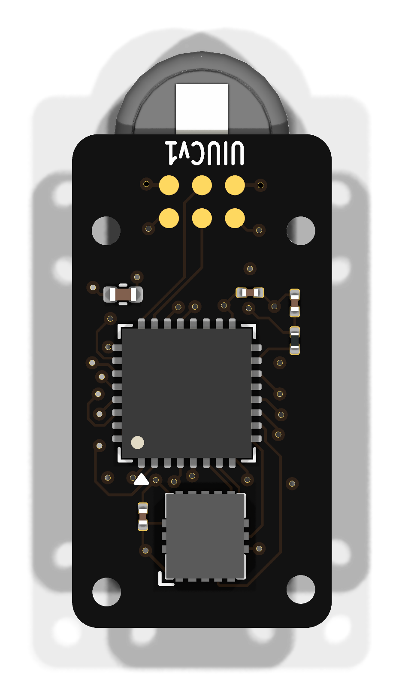
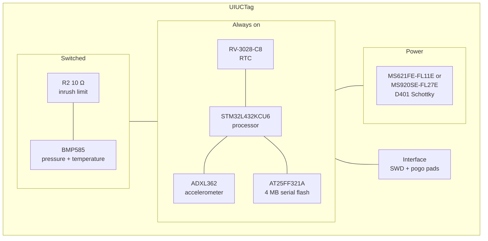

# UIUC Tag (BitPresTag)

The UIUC tag combines the two simplest sensing strategies in the family on one
board: a BitTag's activity accelerometer and a PresTag's pressure sensor. The
board documented here is **UIUCTag**: a Bosch BMP585 for pressure and an ADXL362
for activity, on a 19 × 10 mm, 0.4 mm four-layer board.

## The board

<figure markdown>
  
  <figcaption>Top</figcaption>
</figure>

<figure markdown>
  
  <figcaption>Bottom</figcaption>
</figure>

The 10 ohm inrush resistor sits in series between the processor pin and the pressure sensor's supply. These are rendered from the KiCad layout by `kicad-cli`; see
[Board Designs](../boards/index.md) for how they are regenerated.

## Block diagram

## Major components

| Role | Part | Domain | Notes |
| --- | --- | --- | --- |
| Processor | STM32L432KCU6 | Always on | |
| RTC | RV-3028-C8 | Always on | 32.768 kHz, 1 ppm |
| Sensor | ADXL362BCCZ | Always on | 3-axis accelerometer, activity detection only |
| Sensor | BMP585 | **Switched** | Barometric pressure and temperature |
| Memory | AT25FF321A-UUN | Always on | 4 MB serial flash |
| Power | D401 CDBQC0130L-HF | — | Schottky reverse-polarity protection; no regulator |
| Battery | MS621FE-FL11E or MS920SE-FL27E | — | 5.5 mAh / 230 mg, or 11 mAh / 450 mg |

**The pressure sensor is powered from a processor pin, through a resistor.**
Pin `PB1` drives the net `LPS_PWR`, which passes through a 10 Ω series resistor
`R2` to `LPS_VDD` — the node that actually feeds the sensor's `VDD` and `VDDIO`
along with their decoupling capacitors.

That resistor is not incidental. The BMP585 datasheet specifies a minimum supply
ramp time of 10 µs and states normatively that supplies ramping faster than that
**must** have a 10 Ω series resistor, to avoid damage from repeated power
cycling. Repeated power cycling is precisely this tag's duty cycle. Before R2
was added, the only thing limiting inrush was the processor pin's own output
impedance, which cleared the requirement by somewhere between 1.1× and 2.2× —
and only on an inferred impedance and a firmware speed setting that could change.
With R2 the requirement is met by construction.

!!! note "Back-powering is a firmware contract"

    While `PB1` is low, the sensor's bus lines are still driven from the main
    domain. Firmware must not leave them high, or the sensor can be back-powered
    through its protection diodes.

Two further points worth carrying into firmware. The ADXL362 is driven from
USART2 in synchronous mode, not from an SPI peripheral. And it is used only for
activity detection, in its motion-activated wake-up mode, never in measurement
mode: its `INT2` drives `PA0`/`WKUP1` to wake the processor.

!!! note "Why an ADXL362 and not the ADXL367"

    UIUCTag is BitPresTagBMP585 with its ADXL367 replaced by an ADXL362. The
    ADXL367's inactivity detector has too many problems for this tag, so
    BitPresTagBMP585 will not be fabricated. The ADXL362 land pattern is the one
    already proven on BitTagv7, and the processor pin map is unchanged.

## What it records

Activity and altitude together. The accelerometer produces the same one-bit
activity record a BitTag does, while the pressure sensor adds barometric
altitude on its own schedule. Having both on one tag means an active period can
be read alongside the altitude profile that accompanied it, rather than inferring
one from the other.

## Power

Measured with the **ADXL367** accelerometer UIUCTag replaced, on firmware
[`fw-v0.6`](https://github.com/tag-designs/software/releases/tag/fw-v0.6) at 2.4960 V from an unregulated 2.5 V cell, at the shipped
300 s sample period. UIUCTag itself has not yet been measured.

| State | Current |
| --- | ---: |
| `IDLE` | 0.16 µA |
| `RUNNING`, 300 s period | **0.56 µA** |
| `FINISHED` | 0.16 µA |

The ADXL362's wake-up mode draws 270 nA against the ADXL367's 180 nA (both from
the datasheets), so expect UIUCTag to run about 0.09 µA higher, near 0.65 µA.
That is an estimate, not a measurement. At 0.56 µA the cell alone gives roughly
**410 days** recording on a 5.5 mAh cell and **820 days** on 11 mAh; at 0.65 µA,
about **350** and **700**. Storage has not been analysed for this tag; PresTag,
which carries the same 4 MB flash, turns out to be memory-limited rather than
battery-limited over much of its range, so expect the same question here.

Bring-up of the ADXL367 build measured about 0.76 µA running against the 0.56 µA
above. The difference is real and unexplained; the likeliest cause is
accelerometer configuration, since bring-up was still resolving a pegged ADXL367.

Full log: [UIUCTag power results](https://github.com/tag-designs/software/blob/main/embedded/tags/UIUCTag/design/power-results.md).

## Design files

[Design directory on GitHub](https://github.com/tag-designs/hardware/tree/main/BoardDesigns/Tags/UIUCTag){ .md-button }
[Schematic (PDF)](../schematics/UIUCTag.pdf){ .md-button }
[Design review](https://github.com/tag-designs/hardware/blob/main/BoardDesigns/Tags/UIUCTag/UIUCTag-design-review.md){ .md-button }

The review carries the full STM32L432 pin map, the ADXL362 pinout checked against
the datasheet, the verified fabrication package, and the case-room change that
lengthened the board by 1 mm. The case is in `Mechanical/UIUCTag`.

Two earlier revisions are in the repository: `BoardDesigns/Tags/BitPresTagBMP585`,
the ADXL367 board UIUCTag is derived from, and `BoardDesigns/Tags/BitPresTag`, the
original pairing of an ADXL362 with an ST LPS27HHTW pressure sensor.
